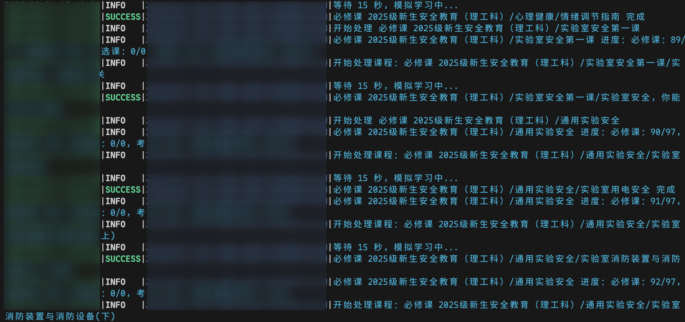
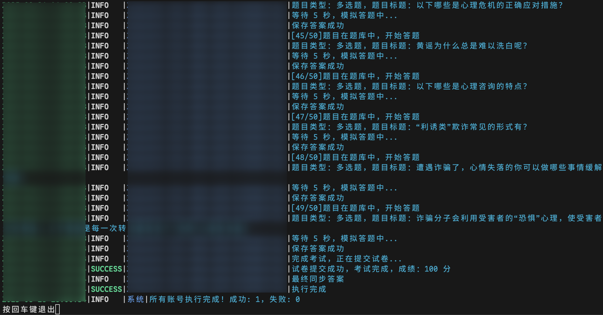
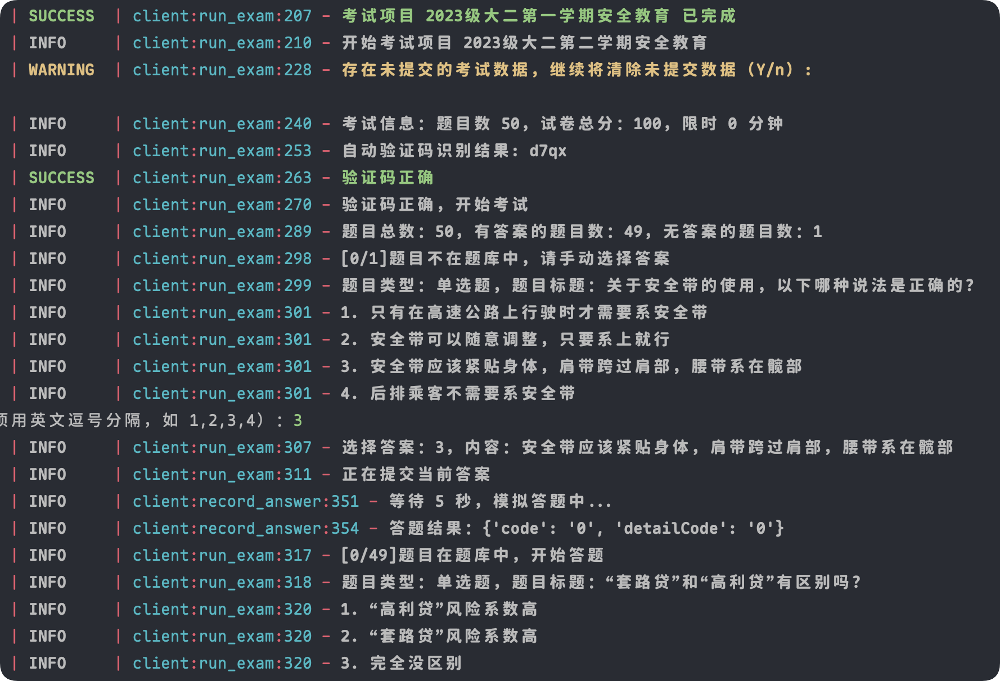
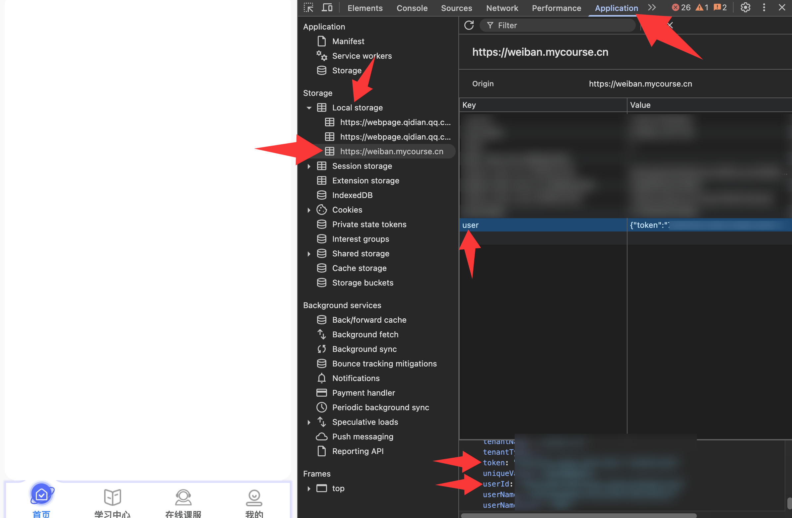
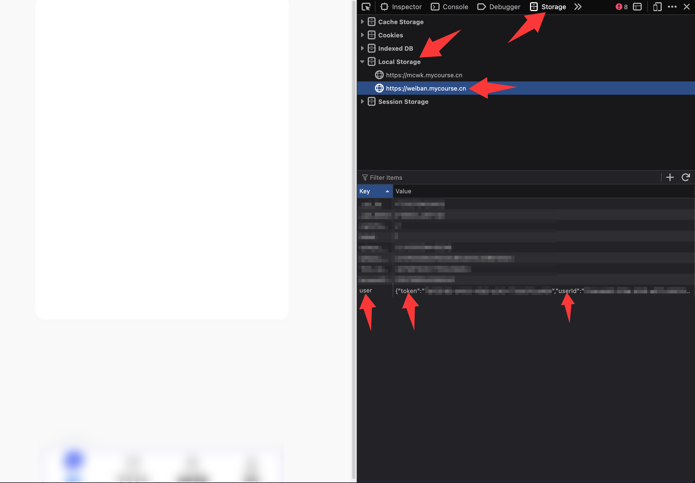

# _WeBan_ 安全微课 安全微伴 大学安全教育

## 介绍

如果本项目帮到了你，可以在右上角点亮 Star，谢谢你！

实现了课程学习和根据题库自动考试，支持多用户多线程运行，自动验证码识别等。

运行前后会自动合并题库，如果一次没满分可以再考一次。可将 `answer/answer.json` 文件提交 PR 一起完善题库。

## 功能特性

- **课程学习**：自动遍历项目 → 分类 → 课程，模拟翻页、答题、等待学习时长后完课；按项目交替完成课程与考试
- **交互式答题与核对控制台（防 AI 出错）**：桌面端考试默认自动打开本地 Web 控制台，后台自动执行题库匹配与 AI 流式搜题，同时支持键盘/鼠标随时暂停、切题、人工纠正选项、单题重跑 AI，且**绝不自动提交试卷**，必须人工二次确认后才交卷（也支持 `--exam-ui-demo` 免登录体验）
- **AI 搜题增强**：
  - **自定义思考强度**：支持配置 OpenAI 标准 `reasoning_effort` 参数（如 `none`/`low`/`medium`/`high`/`xhigh`）
  - **流式思考过程展示**：支持 SSE 流式传输，交互终端下实时淡色显示 LLM 思考过程（自动兼容 `reasoning_content`、`reasoning`、`<think>` 标签），多账号并发防错乱，无交互环境自动缓冲输出，并将思考摘要写入账号日志
  - **多格式参考文档知识库**：支持引入 `.pdf`、`.docx`、`.pptx`、`.xlsx`、`.md`、`.txt`、`.csv`、`.json`、`.html` 等格式资料扩充知识库；采用自适应策略（总长未超阈值时全文注入，超出时自动本地中英文 BM25 检索召回 Top-K 片段），并在 Prompt 中要求 LLM 优先依据参考知识库思考作答
- **验证码识别**：登录验证码自动识别；课程点选验证码自动识别（OpenCV，2 轮 × 3 次），失败才转手动
- **多账号并发**：支持配置多个账号，可多线程同时执行
- **题库同步**：考试前后自动从服务器同步题库，支持多用户共享
- **断点续考**：追求满分模式下，一次未满分可再次考试
- **进度监控**：完课后自动检查进度是否更新，未更新则警告提示
- **调试模式**：开启 `debug` 可查看完整请求/响应日志
- **无交互运行**：Docker / cron / 后台环境自动无交互，数据目录持久化

## 使用

> **零基础三步上手**：① 下载二进制文件 → ② 双击/命令行运行 → ③ 输入学校、学号、密码。不需要安装 Python，不需要写代码。

### ⭐ 快速开始（推荐：下载即用）

**第 1 步：下载你的系统对应的文件**

点这里打开最新版下载页 → [**Releases**](https://github.com/hangone/WeBan/releases/latest)，按自己的电脑系统下载（不确定系统就按下面的表选）：

| 你的电脑                             | 点击下载（GitHub）                                                                                       | 下载太慢用镜像                                                                                                                               |
| ------------------------------------ | -------------------------------------------------------------------------------------------------------- | -------------------------------------------------------------------------------------------------------------------------------------------- |
| Windows（绝大多数电脑）              | [WeBan-windows-x64.exe](https://github.com/hangone/WeBan/releases/latest/download/WeBan-windows-x64.exe) | [镜像](https://gh-proxy.com/https://github.com/hangone/WeBan/releases/latest/download/WeBan-windows-x64.exe) [备用](https://ghfast.top/https://github.com/hangone/WeBan/releases/latest/download/WeBan-windows-x64.exe) |
| Mac 苹果电脑（Intel 芯片）           | [WeBan-macos-x64](https://github.com/hangone/WeBan/releases/latest/download/WeBan-macos-x64)             | [镜像](https://gh-proxy.com/https://github.com/hangone/WeBan/releases/latest/download/WeBan-macos-x64) [备用](https://ghfast.top/https://github.com/hangone/WeBan/releases/latest/download/WeBan-macos-x64)             |
| Mac 苹果电脑（M1/M2/M3/M4 芯片）     | [WeBan-macos-arm64](https://github.com/hangone/WeBan/releases/latest/download/WeBan-macos-arm64)         | [镜像](https://gh-proxy.com/https://github.com/hangone/WeBan/releases/latest/download/WeBan-macos-arm64) [备用](https://ghfast.top/https://github.com/hangone/WeBan/releases/latest/download/WeBan-macos-arm64)         |
| Linux（Ubuntu/Debian/CentOS，64 位） | [WeBan-linux-x64](https://github.com/hangone/WeBan/releases/latest/download/WeBan-linux-x64)             | [镜像](https://gh-proxy.com/https://github.com/hangone/WeBan/releases/latest/download/WeBan-linux-x64) [备用](https://ghfast.top/https://github.com/hangone/WeBan/releases/latest/download/WeBan-linux-x64)             |
| Linux（树莓派/ARM 服务器）           | [WeBan-linux-arm64](https://github.com/hangone/WeBan/releases/latest/download/WeBan-linux-arm64)         | [镜像](https://gh-proxy.com/https://github.com/hangone/WeBan/releases/latest/download/WeBan-linux-arm64) [备用](https://ghfast.top/https://github.com/hangone/WeBan/releases/latest/download/WeBan-linux-arm64)         |

> **Mac 怎么判断芯片**：屏幕左上角 → 关于本机，看"芯片"一栏写的是 Apple M 系列（arm64）还是 Intel（x64）。Windows 不确定就选 x64（2010 年后几乎都是）。

**第 2 步：运行**

- **Windows**：双击 `WeBan-windows-x64.exe`（第一次运行如被 SmartScreen 拦截，点"更多信息" → "仍要运行"；杀毒软件误报请添加信任）
- **Mac**：在文件目录打开终端运行：
  ```bash
  chmod +x WeBan-macos-*
  xattr -cr WeBan-macos-*
  ./WeBan-macos-arm64   # Intel 芯片换成 WeBan-macos-x64
  # 然后可能会卡一会，是苹果在验证签名，等就行
  ```
- **Linux**：
  ```bash
  chmod +x WeBan-linux-*
  ./WeBan-linux-x64     # ARM 服务器换成 WeBan-linux-arm64
  ```

**第 3 步：填账号，开始**

第一次运行（或还没有配置文件时），程序会**直接让你输入学校、用户名、密码**（不用编辑任何文件）：

```
请输入账号信息：
  学校全称（如：XX大学）: XX大学
  用户名（学号/考生号之类的）: <你的账号>
  密码（默认同用户名）: <你的密码>
```

输入后程序会**自动验证账号**：登录成功就会把账号自动保存到配置文件 `config.toml`，然后开始学习和考试；**如果学校全称或用户名密码错了，会提示你重新输入，不会写坏配置文件**。之后每次运行都会接着上次的进度继续。

> 配置文件 `config.toml` 在程序旁边（Windows 是 exe 所在文件夹，Mac/Linux 是运行命令的目录），下次运行前也可以手动改它。用 `--data-dir` 可以指定固定位置（见下方参数表）。

**不想交互输入？一条命令直接跑**（学校/学号/密码写在命令里，无需配置文件）：

```bash
# Windows (PowerShell)
$env:WB_TENANT_NAME="你的学校全称"; $env:WB_USERNAME="你的学号"; $env:WB_PASSWORD="你的密码"; .\WeBan-windows-x64.exe

# mac / Linux
WB_TENANT_NAME="你的学校全称" WB_USERNAME=你的学号 WB_PASSWORD=你的密码 ./WeBan-macos-arm64
```

> 全部参数对照表见下方"参数总览"；账号想保密的、或一个文件管理多个账号的，用配置文件方式。

### 参数总览

**每个配置项都有命令行参数和环境变量两种方式，三类名称一一对应**：配置文件键名（`snake_case`）= 命令行参数（`--kebab-case`）= 环境变量（`WB_SNAKE_CASE`），例如 `study_time` ↔ `--study-time` ↔ `WB_STUDY_TIME`。优先级均为 **命令行 > 环境变量 > 配置文件**：

| 配置文件键               | 参数                         | 环境变量                    | 说明                                                                               |
| ------------------------ | ---------------------------- | --------------------------- | ---------------------------------------------------------------------------------- |
| —                        | `--config PATH`              | `WB_CONFIG`                 | 配置文件路径（默认: 程序目录/config.toml）                                         |
| —                        | `--data-dir PATH`            | `WB_DATA_DIR`               | 数据目录（config/logs/answer 都在此，适合挂载）                                    |
| —                        | `--non-interactive`          | —                           | 无交互模式（环境变量用 `ENVIRONMENT=docker`/`container` 或 stdin 非 TTY 自动判定） |
| `study_mode`             | `--study-mode`               | `WB_STUDY_MODE`             | 学习模式（`false`/`true`/`force`）                                                 |
| `exam_mode`              | `--exam-mode`                | `WB_EXAM_MODE`              | 考试模式（`false`/`true`/`perfect`/`force`）                                       |
| `random_answer`          | `--random-answer`            | `WB_RANDOM_ANSWER`          | 题库外题目是否随机作答（`true`/`false`）                                           |
| `study_time`             | `--study-time SEC`           | `WB_STUDY_TIME`             | 每门课学习时长 `"基础,随机上限"`（秒），如 `"20,5"`                                |
| `video_speed`            | `--video-speed N`            | `WB_VIDEO_SPEED`            | 视频课程倍速：`0`=不按视频时长等待、`1`=原速、`2`=半速（默认）                       |
| `exam_question_time`     | `--exam-question-time SEC`   | `WB_EXAM_QUESTION_TIME`     | 每道考试题答题等待时长 `"基础,随机上限"`（秒）                                     |
| `exam_submit_match_rate` | `--exam-submit-match-rate N` | `WB_EXAM_SUBMIT_MATCH_RATE` | 允许交卷的最低题库匹配率（百分比）                                                 |
| `exam_ui`                | `--exam-ui`                  | `WB_EXAM_UI`                | 是否启用交互式答题与核对页面（`true`/`false`，桌面端默认 `true`，绝不自动交卷）    |
| `exam_ui_port`           | `--exam-ui-port PORT`        | `WB_EXAM_UI_PORT`           | 交互式答题页面本地监听端口（`0`=自动分配）                                         |
| —                        | `--exam-ui-demo`             | —                           | 启动交互式答题演示模式（默认调用已配置的真实 AI 接口与知识库，配合 `--mock` 切离线模拟） |
| `browser_path`           | `--browser-path PATH`        | `WB_BROWSER_PATH`           | 浏览器可执行文件路径                                                               |
| `cdp_host`               | `--cdp-host HOST`            | `WB_CDP_HOST`               | CDP 浏览器地址                                                                     |
| `cdp_port`               | `--cdp-port PORT`            | `WB_CDP_PORT`               | CDP 浏览器端口                                                                     |
| `jupiter_fallback`       | `--jupiter-fallback`         | `WB_JUPITER_FALLBACK`       | 对未加载 apicenext.js 的课程是否补发 jupiter 翻页轨迹                              |
| `max_workers`            | `--max-workers N`            | `WB_MAX_WORKERS`            | 多账号最大并发数                                                                   |
| `debug`                  | `--debug`                    | `WB_DEBUG`                  | 启用调试日志                                                                       |
| `tenant_name`            | `--tenant-name NAME`         | `WB_TENANT_NAME`            | 单账号学校全称（免配置文件）                                                       |
| `username`               | `--username USER`            | `WB_USERNAME`               | 单账号用户名                                                                       |
| `password`               | `--password PASS`            | `WB_PASSWORD`               | 单账号密码（默认同用户名）                                                         |
| `user_id`                | `--user-id ID`               | `WB_USER_ID`                | 单账号用户 ID（Token 登录）                                                        |
| `token`                  | `--token TOKEN`              | `WB_TOKEN`                  | 单账号登录 Token（配合 `--tenant-name --user-id`）                                 |
| `[ai].enable`            | `--ai-enable`                | `WB_AI_ENABLE`              | 是否启用 AI 搜题（`true`/`false`）                                                 |
| `[ai].base_url`          | `--ai-base-url URL`          | `WB_AI_BASE_URL`            | AI 服务 API 基础路径                                                               |
| `[ai].api_key`           | `--ai-api-key KEY`           | `WB_AI_API_KEY`             | AI 服务 API Key                                                                    |
| `[ai].model`             | `--ai-model NAME`            | `WB_AI_MODEL`               | AI 模型名称                                                                        |
| `[ai].api_mode`          | `--ai-api-mode MODE`         | `WB_AI_API_MODE`            | AI 接口协议（`auto`/`responses`/`chat`，默认 `auto`）                              |
| `[ai].timeout`             | `--ai-timeout SEC`             | `WB_AI_TIMEOUT`             | AI 请求超时秒数                                                                    |
| `[ai].max_retries`         | `--ai-max-retries N`           | `WB_AI_MAX_RETRIES`         | AI 请求失败最大重试次数                                                            |
| `[ai].reasoning_effort`    | `--ai-reasoning-effort LEVEL`  | `WB_AI_REASONING_EFFORT`    | AI 思考强度（OpenAI 标准 `reasoning_effort`，如 `none`/`low`/`medium`/`high`/`xhigh`） |
| `[ai].stream`              | `--ai-stream`                  | `WB_AI_STREAM`              | 是否启用 AI 流式传输（`true`/`false`，默认 `true`）                                |
| `[ai].show_thinking`       | `--ai-show-thinking`           | `WB_AI_SHOW_THINKING`       | 是否展示 AI 思考过程（`true`/`false`，默认 `true`）                                |
| `[ai].knowledge_enable`    | `--ai-knowledge-enable`        | `WB_AI_KNOWLEDGE_ENABLE`    | 是否启用参考文档知识库（`true`/`false`，默认 `true`）                              |
| `[ai].knowledge_paths`     | `--ai-knowledge-paths PATHS`   | `WB_AI_KNOWLEDGE_PATHS`     | 额外参考文档文件或目录路径（CLI/env 用分号或逗号分隔）                             |
| `[ai].knowledge_max_chars` | `--ai-knowledge-max-chars N`   | `WB_AI_KNOWLEDGE_MAX_CHARS` | 知识库全文注入阈值与最大上下文字符数（默认 `12000`）                               |
| `[ai].knowledge_top_k`     | `--ai-knowledge-top-k N`       | `WB_AI_KNOWLEDGE_TOP_K`     | BM25 分块检索召回的最大片段数（默认 `5`）                                          |

无交互自动判定：`ENVIRONMENT=docker`（或 container）、stdin 非 TTY（cron/后台/管道）、或显式 `--non-interactive`。

**完全不写 config.toml 也能运行**（单账号 + 全部设置走 CLI/env）：

```bash
# 环境变量
WB_TENANT_NAME="你的学校全称" WB_USERNAME=你的学号 WB_PASSWORD=你的密码 \
WB_STUDY_TIME="20,5" WB_VIDEO_SPEED=0 ./WeBan-macos-arm64
# 或等价的命令行参数
./WeBan-macos-arm64 --tenant-name "你的学校全称" --username 你的学号 \
  --study-time "20,5" --video-speed 0
```

### 交互式答题与核对页面（防 AI 出错）

在桌面交互环境下，`exam_ui = true` 默认开启。进入考试后程序会自动打开本地 Web 控制台：

- **自动执行**：自动标记本地题库命中题，并顺序对未命中题发起 AI 搜题，在右侧面板实时流式显示 AI 思考过程、参考文档来源与作答理由。
- **键鼠双控 + 随时人工纠正**：可在自动答题期间随时暂停、切题、修改选项或切换思考强度重新让 AI 思考；**人工修改过的题目绝不会被后台自动引擎覆盖**。
- **绝不自动交卷**：所有题目作答完成后会停留在“等待人工核对”状态，只有人工点击「提交试卷」（或 `Ctrl+Enter`）并通过二次确认弹窗后才会调用交卷接口；也可以点击「放弃交卷」安全退出（不消耗考试次数）。
- **免登录实测**：运行 `uv run weban --exam-ui-demo` 将直接调用你在 `config.toml` / 环境变量 / CLI 中配置的真实模型 API 与 `knowledge/` 知识库，并在界面实时显示接入的模型与接口、TTFT、TPS、上下文长度、累计 Token（含缓存命中）与 Agent 工具检索轨迹；追加 `--mock` 可切换为离线模拟模式。

常用快捷键：
`←`/`→` 或 `K`/`J` 切题 · `1`-`9` / `A`-`I` 选答案 · `N` 跳下一待核对题 · `V` 标记已核对 · `F` 标星存疑 · `P` 暂停/继续自动答题 · `R` 重跑 AI · `G` 跟随当前执行题 · `Ctrl+Enter` 打开手动提交确认 · `?` 查看帮助。

### AI 搜题与参考文档知识库

当题目未命中本地题库 `answer.json` 且 `[ai].enable = true` 时，程序会自动调用 OpenAI 兼容接口进行答题：

1. **自定义思考强度**：在 `config.toml` 的 `[ai]` 段设置 `reasoning_effort = "high"`（或 `low`/`medium`/`xhigh`/`none`，留空则不传该参数），或通过 `--ai-reasoning-effort` / `WB_AI_REASONING_EFFORT` 覆盖。
2. **流式思考过程显示**：默认开启 `stream = true` 与 `show_thinking = true`，交互式终端会实时以淡色打印模型思考过程，思考完成后输出解析出的推荐选项与理由；无交互环境（如 Docker/后台）会自动缓冲输出，且思考摘要会记录到账号日志。
3. **参考文档知识库**：
   - 将参考资料直接放入程序目录（或 `--data-dir`）下的 `knowledge/` 目录即可自动加载，也可在 `[ai].knowledge_paths` 中配置额外的单文件或目录路径。
   - 支持格式：`.pdf`（文本型 PDF，扫描件将提示先 OCR）、`.docx`（含段落与表格）、`.pptx`（含幻灯片、表格与备注）、`.xlsx`/`.xlsm`、`.md`/`.txt`/`.csv`/`.tsv`/`.json`/`.html` 等。
   - **自适应检索**：资料总字数 ≤ `knowledge_max_chars`（默认 12000）时直接全文注入上下文；超出时自动按段落切块，用本地中英文 BM25 算法综合题干与选项召回最相关的 Top-K 片段（默认 5 条），无需额外 Embedding API。Prompt 会明确要求模型优先依据参考知识库思考并注明来源。

### 源码运行

不需要代码基础的用户跳过本节，直接下载二进制即可。开发者或想改代码时用：

1. 安装 [uv](https://github.com/astral-sh/uv) 和 Git。项目需要 Python 3.14，uv 会按 `.python-version` 自动装好。

2. 克隆仓库并进入目录

```bash
git clone --depth 1 https://github.com/hangone/WeBan
cd WeBan
```

3. 安装依赖

```bash
uv sync
```

4. 运行

```bash
uv run weban
```

`uv run weban --help` 可查看全部参数。

### Docker

提供两种镜像变体（多架构 amd64/arm64，发布时随版本推送）：

| 镜像       | Tag                                            | 说明                           |
| ---------- | ---------------------------------------------- | ------------------------------ |
| 内置浏览器 | `latest` / `with-browser` / `<版本号>`         | 内置 headless Chrome，开箱即用 |
| 轻量镜像   | `without-browser` / `<版本号>-without-browser` | 通过 CDP 连接宿主机浏览器      |

容器默认无交互运行（`ENVIRONMENT=docker` 自动判定），数据全部持久化在 `/app/data`：

```bash
mkdir -p data
docker run --rm \
  -v "$PWD/data":/app/data \
  --cpus 1 \
  hangyi/weban:latest
```

- 建议 `--cpus 1`（详见下方"CPU 配额与验证码"）；首次运行会在 `./data/` 生成 `config.toml` 模板，填写账号后重新运行即可
- 日志在 `./data/logs/<账号>/`，题库在 `./data/answer/`，全部挂载持久化
- 无交互：不弹编辑器、确认用默认值、验证码自动识别失败不等待手动输入（跳过该课）、末尾不等待回车
- 需要交互（如手动输验证码）时用 `docker run -it`（容器检测到 TTY 自动进入交互模式）

所有配置项均可覆盖（命令行参数 > 环境变量 > 配置文件，名称一一对应，见上方参数表）。示例：

```bash
# 环境变量（单账号免配置文件）
docker run --rm -v "$PWD/data":/app/data --cpus 1 \
  -e WB_TENANT_NAME="你的学校全称" -e WB_USERNAME=你的学号 -e WB_PASSWORD=你的密码 \
  -e WB_STUDY_TIME="20,5" -e WB_VIDEO_SPEED=0 \
  hangyi/weban:latest

# 命令行参数（经 entrypoint 透传）
docker run --rm -v "$PWD/data":/app/data --cpus 1 \
  hangyi/weban:latest --tenant-name "你的学校全称" --username 你的学号 \
  --study-time "20,5" --video-speed 0
```

#### CPU 配额与验证码

- **docker 下多核正常**：实测（docker 29.x，2 核 1.9GB）`--cpus 1` / `--cpus 2` × 单进程/多进程全部跑通，真实课程点选验证码在 `--cpus 2` 下完整通过（识别 → 点击 → 提交 → 腾讯 SDK 回调成功），无挂起
- 建议 `--cpus 1`：镜像默认单进程 + 单线程识别（`WB_SINGLE_PROCESS` / `WB_CV_THREADS`），1 核即可跑通全部验证码；多核配额没有性能收益（Chrome 单进程受单核限制），1.9GB 小内存机器用 2 核反而容易内存吃紧
- **podman 已知特例**：podman（如 `podman run --cpus 2`）下 headless-shell 点选验证码**提交后可能挂起**（CDP evaluate 无响应 60s+，1 核正常）——这是 podman 的 CPU 配额调度问题，非程序缺陷；podman 部署请用 `--cpus 1`

#### 轻量镜像（CDP 连接宿主机浏览器）

容器会自动检测 Docker 环境并尝试连接宿主机的 Chrome，无需手动配置 CDP。

**第一步：在宿主机启动 Chrome 远程调试**

打开 Chrome，地址栏输入 `chrome://inspect/#remote-debugging`，勾选 **Allow remote debugging for this browser instance**。

或者直接命令行启动带远程调试的 Chrome：

```bash
# macOS
"/Applications/Google Chrome.app/Contents/MacOS/Google Chrome" --remote-debugging-port=9222

# Linux
google-chrome --remote-debugging-port=9222

# Windows
"C:\Program Files\Google\Chrome\Application\chrome.exe" --remote-debugging-port=9222
```

> 参考：[Chrome DevTools: Debug your browser session](https://developer.chrome.com/blog/chrome-devtools-mcp-debug-your-browser-session)

**第二步：运行容器**

```bash
mkdir -p data
docker run --rm \
  -v "$PWD/data":/app/data \
  hangyi/weban:without-browser
```

如需自定义 CDP 地址，可用 `--cdp-host` / `--cdp-port` 参数或配置文件 `cdp_host` / `cdp_port`。

### 浏览器检测

程序按以下优先级自动检测可用的浏览器，无需手动配置：

1. **用户指定**：配置文件 `browser_path`（或 `--browser-path` / `WB_BROWSER_PATH`）
2. **CDP 远程调试**：配置文件 `cdp_host` + `cdp_port`（或 CLI/env），或 Docker 环境下自动尝试 `host.docker.internal:9222`
3. **Playwright 浏览器**：自动查找 `~/.cache/ms-playwright` 下的 Chromium
4. **系统浏览器**：自动查找已安装的 Chrome / Chromium / Edge

## 油猴脚本（浏览器版）

[`weban.user.js`](weban.user.js) 在浏览器里完成整套流程，**不需要 Python 环境**：自动学完未完成课程、自动处理交互题、自动答题、自动交卷。

**安装**：Tampermonkey → 新建脚本 → 粘贴 `weban.user.js` → 先在官网登录 → 打开 <https://weiban.mycourse.cn/> → 面板点「开始」。

### 解决的实际问题

| 痛点 | 做法 |
| --- | --- |
| 动画太慢 | CSS `animation`/`transition` 压到 0.05s，长 `setTimeout` 按比例压缩 |
| 点击有声音 | **默认静音**：覆盖 audio/video 并拦截 `HTMLMediaElement.play()`，动态插入的媒体也处理 |
| 手动点翻页 | 自动翻到底，再触达完课按钮 |
| 交互题要手点 | 逐选项「点一个 → 提交 → 等复位 → 下一个」，走完页面才放行 |
| 考试手答 | 从 `server.py` 查题库，按答案文本匹配选项 |

### 控制面板

- **学习**：翻页间隔、动画加速开关、静音开关
- **考试**：答题间隔、题库外随机作答
- **辅助服务**：题库/验证码服务地址与 Token
- **日志**：实时滚动、可清空、可复制；顶部进度条显示当前第几门课

### 实测记录（真实课程 A11078，16 页）

- 15 页全流程 **19.8 秒**走完，`pageNums=9`，满足完课条件
- 3 个 `audio` 元素全部 `muted`，动画 `0.05s` 生效
- 交互题 5 个选项逐个点击 + 提交，全部变 `-1.png`，成功放出下一页

### 原理

主站是 Vue + Vuex 应用，接口都封装在 store actions 里。脚本用 `#app.__vue__` 拿根实例后直接 `dispatch` 官方 action，签名、加密、token 全交给页面。课程页则由脚本真实点击按钮驱动，完课请求由页面自己的 `finishWxCourse()` 发出。源码见 `src/online-*/ `（sourcemap 还原）。

### 课程结构适配（52 门实测）

平台课程页面差异极大，实测 52 门课至少 8 种完课方式。脚本不做逐课适配，而是用**通用状态机**：

| 类型 | 数量 | 处理方式 |
| --- | --- | --- |
| 标准翻页 + `btn-next-end` | 7 门 | 翻到底点完课按钮 |
| 翻页 + `btn-at` 选择题 | 4 门 | 从 `item.js` 的 `slFn()` 读答案勾选 |
| `apicenext` 轨迹上报 | 2 门 | 页面自己上报，脚本只管翻页 |
| 纯视频课 | 7 门 | 等播放结束，页面自动完课 |
| 混合型 | 32 门 | 按页面实际出现的元素逐项处理 |

通用机制覆盖率：`finishWxCourse` **49/52**（其余 3 门是视频课，由播放器回调触发）。

**前进按钮**共识别 12 种：`btn-start`、`btn-ce`、`btn-at`、`btn-next`、`page-next-btn`、`answer-btn-next`、`btn-ti`、`page-success-button2`、`pN_next` 等，另有兜底匹配。

### 已知限制

- **视频课不做倍速破解**：官方播放器 `playbackRates` 上限 2 倍，需在播放器菜单手动选；脚本只等它播完
- 页面报错会 `alert`（如重复完课提示"发送完成失败"），脚本已拦截并转为日志，不会卡死
- 已完成课程重复学习时，服务端会拒绝完课，脚本会提示但不算成功

## 辅助服务 weban.server

[`weban/server.py`](weban/server.py) 提供**题库查询**和**验证码识别**，脚本不配也能跑，题库外的题随机、验证码要手点。

```bash
uv run python -m weban.server                          # 127.0.0.1:8765，无鉴权
WB_TOKEN=随机串 uv run python -m weban.server            # 开鉴权
uv run python -m weban.server --host 0.0.0.0 --token 随机串   # 对外，必须带 token
```

| 接口 | 作用 |
| --- | --- |
| `POST /answer/query` | 传 `{title, options}`，返回 `{hit, indexes, answers, matchedBy}` |
| `POST /answer/match` | 一次传多题，返回每题结果 |
| `POST /captcha/point` | 点选验证码 → 3 个坐标 |
| `POST /captcha/text` | 登录验证码 → 4 位字符 |
| `GET /answer/stats` / `GET /health` | 题库统计 / 健康检查 |

题库来自 `answer/answer.json`（3700+ 题），文件改动后自动重载。题目文本会做规范化（去空格标点、全角转半角、小写），所以「带空格或标点不同」的同一道题也能命中。

在脚本面板「辅助服务地址」里填 `http://127.0.0.1:8765` 即可。

安全约束：默认只监听回环地址；对外必须带 token；图片地址限制 https + 域名白名单 + DNS 内网校验（防 SSRF）；请求体与图片都有大小上限；按 IP 限流。

## 演示




## 常见问题

- ### 浏览器检测失败 / 启动失败

关闭代理软件的系统代理再试，或把 `127.0.0.1`、`localhost` 加入代理软件的 bypass 列表。

Chrome 自动更新后首次启动需要额外加载与签名校验，健康检查默认等 30 秒；机器更慢时用 `WB_BROWSER_START_TIMEOUT`（秒）放宽。

- ### 部分无法直接登录的学校/Token 登录方法

有些从迎新系统跳转的可以试试账号密码都是学号，也可以尝试使用 Token 登录，在电脑浏览器登录后按 F12 或者 Ctrl+Shift+I 打开开发者工具，找到本地存储，复制 user 的内容到 config.json 配置文件




- ### 学习

1. 学习时长太低不会计入进度
2. 课程点选验证码会自动识别（无头浏览器 + OpenCV，最多 2 轮 × 3 次，可用 WB_CAPTCHA_ROUNDS/WB_CAPTCHA_ATTEMPTS 调整），失败后在交互模式会打开浏览器手动操作，无交互模式（Docker 等）会跳过该课程并告警
3. 账号锁定后，请等待1小时再按原方式登录
4. 有新手引导时，先在官网完成
5. 单课完课失败会跳过本门并继续后续课程，不自动重发完课请求。未完成课程下次运行会重新学习。账号锁定或登录失效仍停止当前账号，是否完成以平台进度为准。

- ### 考试

据观察，考试未提交是不会消耗考试次数的

## 鸣谢

- [Coaixy/weiban-tool](https://github.com/Coaixy/weiban-tool) 提供题库和一些代码思路
- [pooneyy/WeibanQuestionsBank](https://github.com/pooneyy/WeibanQuestionsBank) 提供题库

## 其他

1. 本项目仅供学习交流使用，请勿用于商业用途。
2. 欢迎 Star 喵，欢迎 PR 喵。
3. 截图时注意打码个人信息。
4. **如果看不懂上面说的也可以直接扫码备注微信号(不要wxid_开头的，搜不到)，乐意效劳。**

   |             微信             |
   | :--------------------------: |
   |  |
